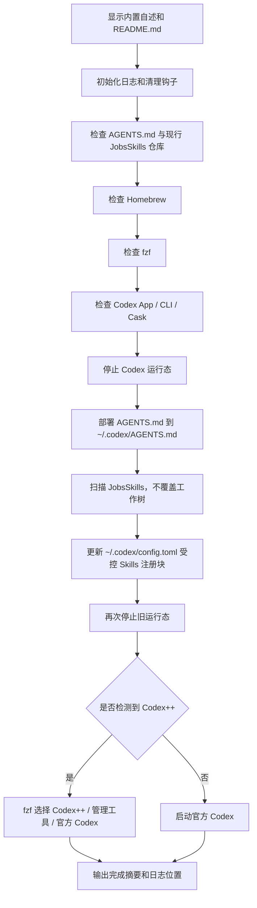

# `💻JobsCodexConfigs`


<!-- jobs-toc:start -->
<!-- jobs-toc:source {"v":2,"token":"[toc]"} -->
<details>
<summary>📚 目录（点击展开 / 收起）</summary>

- [🔥 前言](#jobs-toc-heading-1)
- [一、项目定位](#jobs-toc-heading-2)
- [二、目录结构](#jobs-toc-heading-3)
- [三、部署目标](#jobs-toc-heading-4)
- [四、运行方式](#jobs-toc-heading-5)
  - [4.1、双击运行](#jobs-toc-heading-6)
  - [4.2、终端运行](#jobs-toc-heading-7)
  - [4.3、子模块下载与同步](#jobs-toc-heading-8)
  - [4.4、静态检查](#jobs-toc-heading-9)
- [五、执行前检查](#jobs-toc-heading-10)
- [六、脚本执行流程](#jobs-toc-heading-11)
- [七、Skills 索引](#jobs-toc-heading-12)
- [八、Codex 位置说明](#jobs-toc-heading-13)
  - [8.1、全局指导文件](#jobs-toc-heading-14)
  - [8.2、Skills 位置](#jobs-toc-heading-15)
  - [8.3、Codex++ 管理器可见性](#jobs-toc-heading-16)
- [九、风险说明](#jobs-toc-heading-17)
- [十、日志与排查](#jobs-toc-heading-18)
- [十一、维护原则](#jobs-toc-heading-19)
- [十二、Git 子模块脚本](#git-submodule-scripts)
  - [【MacOS】⏬下载配置当前Git子模块（可向下同步递归）.command](#jobs-toc-heading-21)
- [十三、配置部署脚本](#repository-script-flows)
  - [【MacOS】Codex配置注入替换工具.command](#jobs-toc-heading-23)
- [十四、WorkBuddy 同步](#workbuddy-sync)
  - [【MacOS】同步Codex配置到WorkBuddy.command](#workbuddy-sync-script)

</details>
<!-- jobs-toc:end -->

[本仓目录结构](#repository-layout) · [Git 子模块脚本](#git-submodule-scripts) · [配置部署流程](#repository-script-flows)

---

## <span id="jobs-toc-heading-1" data-jobs-toc="v2">🔥 <font id=前言>前言</font></span><!-- jobs-toc:heading-end -->

[**Git**](https://git-scm.com/) 子模块脚本的用途与执行顺序见[专章说明](#git-submodule-scripts)。

> `💻JobsCodexConfigs` 是 Jobs 本机 [**Codex**](https://openai.com/codex) 全局配置仓库，负责维护 `AGENTS.md`、挂载独立 [**JobsSkills**](https://github.com/JobsKits/JobsSkills) 子模块，并通过脚本部署全局指导与注册现行用户级 Skills。

全局规则以本仓库 `AGENTS.md` 为源头；专项 Skills 以 `$HOME/.agents/skills` 的 `JobsSkills` 工作树为现行基准。父仓中的 `skills` 只是子模块挂载和版本指针，不再保留一份由父仓直接跟踪的 Skills 备份。

<strong id="markdown-toc-sync">同步后文档目录：本地 `[toc]`，提交后发布折叠目录</strong>

本地编辑保留独占行 `[toc]`；整文件暂存时由 [**Git**](https://git-scm.com/) 过滤器生成按标题层级缩进、默认收起的可折叠目录，正常提交推送后供远端展示。下载入口逐仓检查已生效的 `filter.jobs-markdown-toc` 配置，再决定是否恢复当前工作区；父仓配置不能代替子仓配置。

| 本仓配置与工具 | 同步入口处理 | 结果与依赖 |
| --- | --- | --- |
| 已有有效目录过滤器 | 执行本仓 `.jobs-markdown-toc/MarkdownToc.mjs restore`，再执行 `verify`；已有工作树即使没有新提交，也显式恢复当前正文 | 需要可用的 [**Node.js**](https://nodejs.org) 和完整目录工具；保留正文及原暂存语义 |
| 未配置有效目录过滤器 | 明确跳过目录恢复，不自动安装、注册或改写 Git 配置 | 不额外依赖 Node.js；跳过不代表已有生成目录已恢复为 `[toc]` |
| 已有有效过滤器，但缺少 Node.js / 工具，或还原、验证失败 | 报出具体仓库并停止本轮同步 | 处理该仓配置或工具后重试，不能将本轮视为全部成功 |

默认只拉取的首次克隆先以 `--no-checkout` 复制已预检对象，记录真实远端地址后才首次安全检出，让按真实 URL 匹配的机器过滤器有机会生效；不会为此再次联网获取未经预检的提交。已有生成目录的恢复以当前磁盘正文为来源，不从旧 `HEAD` 或暂存区覆盖正文，也不自动暂存、提交或推送。当前机器尚未注册或换机后没有有效配置时，仍按表中“跳过”处理，不能承诺首次落盘已经是 `[toc]`。

<strong id="readonly-submodule-mode">先选用途：只拉取电脑默认跟随分支最新，子仓保持本地分支</strong>

| 启动选择 | 版本依据 | 是否写入父仓提交 |
| --- | --- | --- |
| 只拉取，默认 | 更新当前父仓明确的远程上游，再逐层跟随子仓目标分支最新提交，保持本地跟踪分支 | 不暂存、不提交、不推送 |
| 维护子模块，显式选择 | 按本仓清单及原有菜单，把所选子树更新到各自远端目标分支最新 | 沿用 `AUTO_PARENT_COMMIT` / `AUTO_PARENT_PUSH` 原有开关 |

启动第一屏显示同步策略版本 `2026.10.21-toc`。新电脑须先取得并运行带此版本号的入口；另一台电脑上的本地修改不会自动更新到新电脑。任一仓库拉取、分支切换或递归校验失败时，本轮不能视为全部完成；处理日志中的具体路径后重新运行。

只拉取模式从脚本所在仓库向下递归处理全部已登记子模块；不向上处理，不使用清单新增关联，也不把子仓最新提交自动提交回父仓。各层优先使用直接父仓 `.gitmodules` 的显式 `branch`，`.` 继承该层计划更新后的直接父仓分支；未配置时读取该子仓远端默认分支。首次下载和已有游离 HEAD 都会恢复或创建对应本地跟踪分支，获取最新提交并快进；成功结束时子仓显示实际分支名。每层相对 URL 随当前父仓的下载线路解析。只拉取模式使用系统 Git、zsh、Perl 等现有工具；仅命中有效目录过滤器时另需 Node.js 和该仓完整目录工具，不进入维护模式的 Homebrew / fzf 安装流程。

子仓源码、未跟踪内容、已暂存 gitlink、未完成操作或本地独有提交会报出具体路径并停止；不会强制覆盖或丢弃独有的游离提交，父仓 `YES` 不扩散到子仓。当前父仓自己的源码改动或本地独有提交，仍须红字列明并精确输入 `YES` 才舍弃。目标分支不存在、远端默认分支无法确定或最新提交获取失败时，停止并报告对应仓库与来源；不会把旧 gitlink SHA 当作最新分支结果。

只拉取模式在入口仓已有本地分支时仍要求明确上游。入口仓自身处于游离 HEAD 时，先使用直接父仓 `.gitmodules` 的显式 `branch`，`.` 继承直接父仓当前分支；无配置时读取 `origin` 或唯一远端的默认分支。已有目标本地分支须明确跟踪所选远端的同名分支；先获取最新提交，预检整棵子树与提交历史，并复查确认期间的状态，再恢复或创建本地跟踪分支。入口源码未提交、需继承分支时直接父仓同样游离、目标不明、目标分支无法快进或存在未受引用保护的独有游离提交时停止；普通父仓的 `YES` 不授权舍弃这些提交。

`REMOTE_NAME` 等原有清单参数只用于维护模式。设置 `DRY_RUN=1` 时，默认只拉取会停止并提示选择维护演练，不能忽略演练标志后执行真实更新。未初始化但存在旧 Git 缓存的空工作树须先恢复，脚本不会覆盖缓存内索引或独有提交。

下文关于清单新增、多选、可切换同步深度、目录清理及自动提交的既有流程，均指显式选择的**维护模式**。只拉取模式默认向下递归到分支最新，不使用这些写入父仓的开关；子仓最新提交与父仓 gitlink 可能不同，父仓会显示待审阅的子模块指针改动。两种模式都保留各仓独立清单和来源显示；只拉取日志带运行时间与进程号，终端会输出实际路径。

维护模式补齐或新增登记时，不自动写入 `branch = main`；已有 `branch` 与缺省状态均保留。显式 `branch` 严格指定目标分支，`.` 继承直接父仓分支；未配置时跟随子仓远端默认分支。目标不存在、直接父仓分支无法确定或远端默认分支无法确定时停止。

<strong id="submodule-quick-look">父子仓多平台地址速览</strong>

当前 `./.gitmodules` 使用相对地址，挂载独立 `JobsSkills` 仓库：

```ini
[submodule "skills"]
    path = skills
    url = ../JobsSkills.git
    branch = main
```

下表展示原生 Git 从父仓地址解析相对 URL 的结果，前提是全新克隆且没有本地 URL 覆盖。前两行来自本地已配置的 [**GitHub**](https://github.com) / [**Gitee**](https://gitee.com) 远端；自建平台仅为结构示例，未部署。

| 平台 | 父仓克隆地址 | 子仓解析地址 |
| --- | --- | --- |
| GitHub | `git@github.com:JobsKits/JobsCodexConfigs.git` | `git@github.com:JobsKits/JobsSkills.git` |
| Gitee | `git@gitee.com:JobsGo/JobsCodexConfigs.git` | `git@gitee.com:JobsGo/JobsSkills.git` |
| 自建平台，仅结构示例 | `ssh://git@git.example.com:2222/team/JobsCodexConfigs.git` | `ssh://git@git.example.com:2222/team/JobsSkills.git` |

`path` 是本地挂载目录，`url` 是独立子仓位置；相对 URL 跟随父仓默认远端的平台、组织、协议与端口，前提是该平台已有对应子仓及父仓锁定的提交。已有克隆须核对默认远端和本地子模块配置，仅新增 remote 不会切换线路；父仓仍只跟踪 `skills` 的 gitlink。

---

**下载脚本的 Gitee 传输规则：** `【MacOS】⏬下载配置当前Git子模块（可向下同步递归）.command` 在本次运行中，将 `git@gitee.com:`、`ssh://git@gitee.com/`、`ssh://git@gitee.com:22/` 开头的标准地址统一通过 `https://gitee.com/` 访问，保留账号、真实仓名和分支；即使设置 `GIT_URL_STYLE=ssh`，这类 Gitee 地址仍使用 HTTPS。各层首次克隆和后续拉取都继承该规则，历史子模块中的 SSH 地址无需新电脑先配置 SSH 密钥。

规则通过追加进程级 `GIT_CONFIG_COUNT` / `url.https://gitee.com/.insteadOf` 配置传给子进程，不写入全局 Git 配置，也不依赖其它工程路径。GitHub、其它主机及非 `22` 的自定义 SSH 端口保持原规则。克隆或递归更新失败会返回非零状态，停止本轮同步并保留错误；不会再输出该项同步成功。各仓清单与浅克隆参数保留；全量同步默认逐仓复用已有工作区，空或缺失目录才首次克隆，不批量删除旧仓名目录、多层子树或缓存。未提交内容须逐仓处理，精确 `YES` 仅放弃当前仓自己的内容。

## <span id="jobs-toc-heading-2" data-jobs-toc="v2">一、项目定位 <a href="#前言" style="font-size:17px; color:green;"><b>🔼</b></a> <a href="#🔚" style="font-size:17px; color:green;"><b>🔽</b></a></span><!-- jobs-toc:heading-end -->

`💻JobsCodexConfigs` 面向 Jobs 本机 Codex 工作流，核心目标如下：

- 维护全局长期规则：仓库根目录 `AGENTS.md`。
- 维护专项规则：独立 `JobsSkills` 仓库中的 `<skill-name>/SKILL.md`。
- 记录聚合关系：`skills` 作为 `JobsSkills` 子模块，父仓只跟踪 gitlink 指针。
- 执行配置注入：部署 `AGENTS.md`，扫描现行 `JobsSkills` 工作树并更新 `~/.codex/config.toml` 受控注册块。

本仓库不做这些事：

- 不替换整个 `~/.codex`。
- 不清空 `~/.codex`、日志、会话、数据库或登录态。
- 不把 `~/.codex/AGENTS.md` 回写到仓库。
- 配置注入流程不反向覆盖 `$HOME/.agents/skills` 现行工作树；手动双向同步由 `skills/同步Skills.command` 单独选择和确认。
- 不把所有专项规则重新塞回 `AGENTS.md`。

---

<a id="repository-layout"></a>

## <span id="jobs-toc-heading-3" data-jobs-toc="v2">二、目录结构 <a href="#前言" style="font-size:17px; color:green;"><b>🔼</b></a> <a href="#🔚" style="font-size:17px; color:green;"><b>🔽</b></a></span><!-- jobs-toc:heading-end -->

```text
💻JobsCodexConfigs/
├── AGENTS.md
├── README.md
├── LICENSE
├── icon.png
├── config.toml（Token中转站的配置）.toml
├── 【MacOS】Codex配置注入替换工具.command
├── 【MacOS】同步Codex配置到WorkBuddy.command
├── 【MacOS】⏬下载配置当前Git子模块（可向下同步递归）.command
├── .gitmodules
└── skills/（JobsSkills Git 子模块）
```

子仓说明：[JobsSkills README](./skills/README.md)。该目录独立维护，本仓只记录关联与提交指针。

关键文件说明：

| 文件 / 目录 | 作用 |
| --- | --- |
| `AGENTS.md` | Codex 全局指导源文件，部署到 `~/.codex/AGENTS.md`。 |
| `skills/` | `JobsSkills` Git 子模块挂载；父仓只记录子仓提交指针。 |
| `skills/同步Skills.command` | 手动选择系统 → 子模块或子模块 → 系统，用 [**fzf**](https://formulae.brew.sh/formula/fzf) 多选 Skills，默认全部同步，预览确认并备份已有目标。 |
| `【MacOS】⏬下载配置当前Git子模块（可向下同步递归）.command` | 下载、登记和同步 `JobsSkills` 子模块。 |
| `【MacOS】Codex配置注入替换工具.command` | 检查环境、部署 `AGENTS.md`、注册现行 `JobsSkills` 并重启 Codex；不覆盖 Skills 工作树。 |
| `【MacOS】同步Codex配置到WorkBuddy.command` | 把 `skills/` 单向部署到 `~/.workbuddy/skills/`，不碰 `~/.codex`；原全局规约渲染（依赖 `workbuddy/AGENTS.workbuddy.md`）已于 2026-10-19 随镜像目录移除而停用。 |
| `config.toml（Token中转站的配置）.toml` | Token 中转站 / model provider 配置参考，不由脚本整文件部署。 |
| `README.md` | 本仓库说明文档，也是脚本运行前展示的主要自述。 |

---

## <span id="jobs-toc-heading-4" data-jobs-toc="v2">三、部署目标 <a href="#前言" style="font-size:17px; color:green;"><b>🔼</b></a> <a href="#🔚" style="font-size:17px; color:green;"><b>🔽</b></a></span><!-- jobs-toc:heading-end -->

| 仓库来源 | 系统目标位置 | 部署行为 |
| --- | --- | --- |
| `AGENTS.md` | `~/.codex/AGENTS.md` | 创建 `~/.codex` 后覆盖写入全局指导文件。 |
| `$HOME/.agents/skills/*/SKILL.md` | `~/.codex/config.toml` | 扫描现行 `JobsSkills` 工作树，删除并重写 Jobs 受控的 `[[skills.config]]` 注册块。 |
| `skills` 子模块 | `💻JobsCodexConfigs` Git 索引 | 只记录 `JobsSkills` 提交指针，不覆盖用户级工作树。 |
| `skills/*/SKILL.md` | `~/.workbuddy/skills/<name>/SKILL.md` | 只部署带托管标记的目录，覆盖前备份；无标记同名目录默认跳过。 |

可以用环境变量临时改目标：

```shell
TARGET_CODEX_DIR="$HOME/.codex" \
TARGET_SKILLS_DIR="$HOME/.agents/skills" \
TARGET_CODEX_CONFIG="$HOME/.codex/config.toml" \
./"【MacOS】Codex配置注入替换工具.command"
```

一般不需要改，默认位置就是当前 MacOS 用户固定位置。

---

## <span id="jobs-toc-heading-5" data-jobs-toc="v2">四、运行方式 <a href="#前言" style="font-size:17px; color:green;"><b>🔼</b></a> <a href="#🔚" style="font-size:17px; color:green;"><b>🔽</b></a></span><!-- jobs-toc:heading-end -->

### <span id="jobs-toc-heading-6" data-jobs-toc="v2">4.1、双击运行 <a href="#前言" style="font-size:17px; color:green;"><b>🔼</b></a> <a href="#🔚" style="font-size:17px; color:green;"><b>🔽</b></a></span><!-- jobs-toc:heading-end -->

- 在 [**Finder**](https://support.apple.com/guide/mac-help/welcome/mac) 中双击：

  ```text
  【MacOS】Codex配置注入替换工具.command
  ```

- 脚本启动后会先展示内置自述和本 `README.md`，确认无误后按回车继续。
- 确认前按 `Ctrl+C` 可以取消，不会继续执行部署流程。

### <span id="jobs-toc-heading-7" data-jobs-toc="v2">4.2、终端运行 <a href="#前言" style="font-size:17px; color:green;"><b>🔼</b></a> <a href="#🔚" style="font-size:17px; color:green;"><b>🔽</b></a></span><!-- jobs-toc:heading-end -->

```shell
cd "."
chmod +x "【MacOS】Codex配置注入替换工具.command"
./"【MacOS】Codex配置注入替换工具.command"
```

### <span id="jobs-toc-heading-8" data-jobs-toc="v2">4.3、子模块下载与同步 <a href="#前言" style="font-size:17px; color:green;"><b>🔼</b></a> <a href="#🔚" style="font-size:17px; color:green;"><b>🔽</b></a></span><!-- jobs-toc:heading-end -->

```shell
./"【MacOS】⏬下载配置当前Git子模块（可向下同步递归）.command"
```

脚本清单管理 `JobsSkills` 到父仓 `skills` 路径的子模块关系，实际下载地址依 `.gitmodules` 与 `REMOTE_NAME` 解析。

需要在本地子模块与系统用户级 Skills 之间复制内容时，运行 `./skills/同步Skills.command`。选择方向后进入 fzf 多选菜单，第一项默认“全部同步”；预览确认后备份已有目标，再同步所选包。具体范围、取消方式和日志见 [Skills 同步说明](./skills/README.md)。

### <span id="jobs-toc-heading-9" data-jobs-toc="v2">4.4、静态检查 <a href="#前言" style="font-size:17px; color:green;"><b>🔼</b></a> <a href="#🔚" style="font-size:17px; color:green;"><b>🔽</b></a></span><!-- jobs-toc:heading-end -->

修改脚本后，至少执行一次语法检查：

```shell
zsh -n "【MacOS】Codex配置注入替换工具.command"
zsh -n "【MacOS】⏬下载配置当前Git子模块（可向下同步递归）.command"
```

---

## <span id="jobs-toc-heading-10" data-jobs-toc="v2">五、执行前检查 <a href="#前言" style="font-size:17px; color:green;"><b>🔼</b></a> <a href="#🔚" style="font-size:17px; color:green;"><b>🔽</b></a></span><!-- jobs-toc:heading-end -->

执行脚本前建议确认：

| 检查项 | 说明 |
| --- | --- |
| 仓库位置 | 配置注入脚本必须能向上定位到包含 `AGENTS.md` 的仓库根目录。 |
| `AGENTS.md` | 必须存在，作为全局指导源文件。 |
| `JobsSkills` | `$HOME/.agents/skills` 必须是关联 `JobsKits/JobsSkills` 的 Git 工作树，且至少存在一个 `SKILL.md`。 |
| [**Homebrew**](https://brew.sh/) | 脚本会检测；不存在时会询问是否安装。 |
| [**fzf**](https://formulae.brew.sh/formula/fzf) | 用于 Codex++ 启动入口选择；不存在时会询问是否安装。 |
| [**Codex**](https://openai.com/codex) | 脚本会检查 App、CLI 或 Homebrew Cask；缺失时会询问是否安装。 |

涉及升级或安装的动作都需要用户交互确认；直接回车会跳过可选升级 / 自检项。

---

## <span id="jobs-toc-heading-11" data-jobs-toc="v2">六、脚本执行流程 <a href="#前言" style="font-size:17px; color:green;"><b>🔼</b></a> <a href="#🔚" style="font-size:17px; color:green;"><b>🔽</b></a></span><!-- jobs-toc:heading-end -->



脚本主要动作：

1、展示 `README.md`，按回车后继续。

2、校验 `AGENTS.md` 与现行 `JobsSkills` Git 工作树。

3、检查 [**Homebrew**](https://brew.sh/)、[**fzf**](https://formulae.brew.sh/formula/fzf)、[**Codex**](https://openai.com/codex)。

4、停止当前 Codex 运行态，避免运行中读取旧配置。

5、覆盖部署 `AGENTS.md` 到 `~/.codex/AGENTS.md`。

6、扫描 `$HOME/.agents/skills`，收集 Skills 注册项，不复制、删除或覆盖仓库内容。

7、更新 `~/.codex/config.toml` 中 Jobs 受控的 Skills 注册块。

8、根据本机是否存在 Codex++，选择增强入口或官方 Codex 启动。

---

## <span id="jobs-toc-heading-12" data-jobs-toc="v2">七、Skills 索引 <a href="#前言" style="font-size:17px; color:green;"><b>🔼</b></a> <a href="#🔚" style="font-size:17px; color:green;"><b>🔽</b></a></span><!-- jobs-toc:heading-end -->

全局长期行为写入本仓库 `AGENTS.md`，具体技术栈规则写入独立 `JobsSkills` 仓库对应 `<skill-name>/SKILL.md`。父仓的 `skills` 子模块只记录已采用版本。

| Skill | 适用场景 |
| --- | --- |
| `jobs-macos-shell` | MacOS 原生 Shell、zsh、`.sh`、`.command`、内置自述、防误触确认、函数拆分、`main` 入口、[**Homebrew**](https://brew.sh/)、自检、批量脚本、压缩包输出或 Sourcetree 自定义动作脚本。 |
| `jobs-git-repository` | `JobsMacEnvVarConfigs`、[**Git**](https://git-scm.com/) 仓库结构、安装与升级入口、仓库级配置同步规则。 |
| `jobs-markdown-docs` | [**Markdown**](https://markdown.cn)、`README.md`、技术文档、表格、流程图、外链、专有名词链接、文档封面和文档结构。 |
| `jobs-podspec` | [**CocoaPods**](https://cocoapods.org/)、`*.podspec`、`source_files`、`public_header_files`、`resource_bundles`、`xcconfig`、`JobsPodspecKit.rb` 或本地 Pod 发布配置。 |
| `jobs-objective-c-pods` | [**Objective-C**](https://developer.apple.com/library/archive/documentation/Cocoa/Conceptual/ProgrammingWithObjectiveC/Introduction/Introduction.html)、本地 Pods、Core / Support、头文件引用、Pod 拆分、`JobsDefineProperty`、`JobsOCDSL`、`JobsModelDSL`、`JobsBlock`、`JobsMake`、`import` 排序或 [**Xcode**](https://developer.apple.com/xcode) Markdown 引用。 |
| `jobs-swift` | [**Swift**](https://www.swift.org/)、Swift 文件组织、`JobsSwiftDSL`、点语法链式调用、懒加载、[**SnapKit**](https://github.com/SnapKit/SnapKit)、导航栏配置、控制器组织或 Swift `return self` 收口。 |
| `jobs-python` | [**Python**](https://www.python.org)、脚本、命令行入口、日志、异常、依赖、格式化、lint 或测试规则。 |
| `jobs-dart-flutter` | [**Dart**](https://dart.dev)、[**Flutter**](https://flutter.dev/)、Widget 拆分、状态管理、路由、资源、iOS / Android 打包、Gradle、Flutter SDK 或代码生成。 |

维护原则：

- 命中某类任务时，优先加载对应 Skill 的完整规则。
- 多领域任务可以组合多个 Skill，例如整理 `.command` 并写 `README.md` 时，同时参考 `jobs-macos-shell` 和 `jobs-markdown-docs`。
- Skill 内规则与 `AGENTS.md` 冲突时，`AGENTS.md` 只管全局边界，具体工程实践以对应 Skill 为准。

---

## <span id="jobs-toc-heading-13" data-jobs-toc="v2">八、Codex 位置说明 <a href="#前言" style="font-size:17px; color:green;"><b>🔼</b></a> <a href="#🔚" style="font-size:17px; color:green;"><b>🔽</b></a></span><!-- jobs-toc:heading-end -->

### <span id="jobs-toc-heading-14" data-jobs-toc="v2">8.1、全局指导文件 <a href="#前言" style="font-size:17px; color:green;"><b>🔼</b></a> <a href="#🔚" style="font-size:17px; color:green;"><b>🔽</b></a></span><!-- jobs-toc:heading-end -->

| 位置 | 说明 |
| --- | --- |
| `~/.codex/AGENTS.md` | Codex 全局指导文件。脚本会用本仓库根目录 `AGENTS.md` 覆盖部署到这里。 |
| `~/.codex/AGENTS.override.md` | 临时全局覆盖文件。正常长期规则不建议写这里。 |
| `<repo>/AGENTS.md` | 仓库级指导文件，适合某个具体项目的规则。 |
| `<repo>/子目录/AGENTS.md` | 子目录级规则，越靠近当前工作目录越具体。 |

`~/.codex/AGENTS.md` 是全局指导文件位置，不是 Skills 主目录。

### <span id="jobs-toc-heading-15" data-jobs-toc="v2">8.2、Skills 位置 <a href="#前言" style="font-size:17px; color:green;"><b>🔼</b></a> <a href="#🔚" style="font-size:17px; color:green;"><b>🔽</b></a></span><!-- jobs-toc:heading-end -->

| 位置 | 作用 |
| --- | --- |
| `$HOME/.agents/skills` | 用户级 Skills，同时是现行 `JobsSkills` Git 基准工作树；配置注入脚本只读取并注册。 |
| `<repo>/.agents/skills` | 仓库级 Skills，适合项目团队共享。 |
| `$SYSTEM_CONFIG_DIR/codex/skills` | 管理员级 Skills，适合机器级共享。 |
| Codex 内置 | 系统级 Skills，由 Codex 自带。 |

Skill 基本结构：

```text
skill-name/
└── SKILL.md
```

`SKILL.md` 必须包含 `name` 和 `description` 元数据。Codex 会先读取技能名称、描述和路径，只有命中任务时才加载完整 `SKILL.md`。

### <span id="jobs-toc-heading-16" data-jobs-toc="v2">8.3、Codex++ 管理器可见性 <a href="#前言" style="font-size:17px; color:green;"><b>🔼</b></a> <a href="#🔚" style="font-size:17px; color:green;"><b>🔽</b></a></span><!-- jobs-toc:heading-end -->

官方 Codex 会从 `$HOME/.agents/skills` 扫描用户级 Skills。Codex++ 管理器的「工具与插件 / Skills」页签通常展示 `~/.codex/config.toml` 中的 `[[skills.config]]` 条目。

脚本会维护如下受控块：

```toml
# >>> JobsCodexConfigs managed skills >>>
# 由 JobsCodexConfigs 配置注入脚本生成。
# 目的：让 Codex++ 管理器的 Skills 页签识别 JobsSkills 用户级仓库。
# 官方 Codex 的真实 Skill 文件仍位于：$HOME/.agents/skills

[[skills.config]]
path = "$HOME/.agents/skills/jobs-swift/SKILL.md"
enabled = true
# <<< JobsCodexConfigs managed skills <<<
```

脚本只删除并重写这段受控块，保留用户自己维护的 MCP、provider、plugin、projects 等配置。

---

## <span id="jobs-toc-heading-17" data-jobs-toc="v2">九、风险说明 <a href="#前言" style="font-size:17px; color:green;"><b>🔼</b></a> <a href="#🔚" style="font-size:17px; color:green;"><b>🔽</b></a></span><!-- jobs-toc:heading-end -->

本脚本会修改当前用户环境，风险边界如下：

| 动作 | 风险 | 说明 |
| --- | --- | --- |
| 覆盖 `~/.codex/AGENTS.md` | 中 | 目标文件会被本仓库 `AGENTS.md` 覆盖。 |
| 扫描 `$HOME/.agents/skills` | 低 | 只读取 `SKILL.md` 路径用于生成注册块，不复制、删除或覆盖仓库。 |
| 更新 `~/.codex/config.toml` 受控块 | 低 | 只更新 `# >>> JobsCodexConfigs managed skills >>>` 到 `# <<< JobsCodexConfigs managed skills <<<` 之间内容。 |
| 停止 Codex 运行态 | 中 | 会尝试退出 `Codex` / `codex` 进程，必要时强制终止旧进程。 |
| 安装或升级工具 | 中 | [**Homebrew**](https://brew.sh/)、[**fzf**](https://formulae.brew.sh/formula/fzf)、Codex Cask 安装或升级都需要交互确认。 |

脚本不会清空 `~/.codex`，不会删除 Codex 会话、日志、数据库、登录态，也不会把系统运行态文件回写到仓库。

---

## <span id="jobs-toc-heading-18" data-jobs-toc="v2">十、日志与排查 <a href="#前言" style="font-size:17px; color:green;"><b>🔼</b></a> <a href="#🔚" style="font-size:17px; color:green;"><b>🔽</b></a></span><!-- jobs-toc:heading-end -->

日志文件位于：

```text
$TMPDIR/【MacOS】Codex配置注入替换工具.log
```

常用排查命令：

```shell
tail -n 120 "$TMPDIR/【MacOS】Codex配置注入替换工具.log"
zsh -n "【MacOS】Codex配置注入替换工具.command"
ls -la "$HOME/.codex"
ls -la "$HOME/.agents/skills"
```

常见问题：

| 问题 | 处理方式 |
| --- | --- |
| 找不到 `AGENTS.md` | 确认脚本位于 `💻JobsCodexConfigs` 仓库内，或可从脚本所在目录向上找到仓库根目录。 |
| `JobsSkills origin 不匹配` | 确认 `$HOME/.agents/skills` 是从 `JobsKits/JobsSkills` 克隆的现行工作树。 |
| `fzf` 菜单无法显示 | 建议双击 `.command` 或在完整 Terminal TTY 中运行。 |
| Codex++ 未出现 | 脚本会回退启动官方 Codex；也可以手动打开 `$APPLICATIONS_DIR/Codex++.app` 或 `~/Applications/Codex++.app`。 |
| `config.toml` 注册不显示 | 确认 `~/.codex/config.toml` 中存在 Jobs 受控块，并确认对应 `SKILL.md` 路径存在。 |
| Skill 内容没生效 | 确认 `$HOME/.agents/skills/<skill-name>/SKILL.md` 已更新，并重启 Codex。 |

---

## <span id="jobs-toc-heading-19" data-jobs-toc="v2">十一、维护原则 <a href="#前言" style="font-size:17px; color:green;"><b>🔼</b></a> <a href="#🔚" style="font-size:17px; color:green;"><b>🔽</b></a></span><!-- jobs-toc:heading-end -->

- `AGENTS.md` 以本仓库为源头；Skills 以独立 `JobsSkills` 仓库为源头。
- `💻JobsCodexConfigs/skills` 只是子模块挂载，父仓不直接跟踪其内部文件。
- 长期全局行为写 `AGENTS.md`。
- 专项技术栈规则以 `$HOME/.agents/skills/<skill-name>/SKILL.md` 现行工作树为基准。
- 修改专项规则后先在 `JobsSkills` 独立仓库提交、推送，再更新父仓子模块指针。
- 运行态数据库、日志、会话、认证文件不归本脚本管理。
- 修改脚本后执行 `zsh -n`，确认语法通过再运行。

[**Homebrew**](https://brew.sh/) 安装路径由用户选择：已有可运行安装时复用；确实需要安装时先强提示，只有精确输入大写 `YES` 才选择系统标准目录，其它输入或直接回车选择当前用户的 `.local/homebrew`。`YES` 只表示选择路径，权限与密码由官方安装器实际处理；有管理员权限也可以选用户目录。选定路径失败立即停止，不自动切换；`Ctrl+C` / 输入结束取消整个任务。

## 十二、<span id="git-submodule-scripts">Git 子模块脚本</span> <a href="#前言" style="font-size:17px; color:green;"><b>🔼</b></a> <a href="#🔚" style="font-size:17px; color:green;"><b>🔽</b></a>

### <span id="jobs-toc-heading-21" data-jobs-toc="v2">[【MacOS】⏬下载配置当前Git子模块（可向下同步递归）.command](./【MacOS】⏬下载配置当前Git子模块（可向下同步递归）.command)</span><!-- jobs-toc:heading-end -->

> **目的：** 默认递归拉取已登记子模块目标分支的最新提交，保持本地跟踪分支；显式维护模式保留清单与登记能力。

- 启动时回车默认进入[只拉取模式](#readonly-submodule-mode)，先预检本地状态，再更新当前父仓并逐层快进到子仓目标分支最新提交；恢复已有游离 HEAD，不提交、不推送。
- 显式选择维护模式后，按以下原有清单和菜单流程处理。

* 阅读说明并确认，定位父仓，载入脚本清单（`JobsSkills` 挂载到 `skills`）。

* 检查父仓远端和分支，先拉取父仓更新。
  * 父仓有未提交改动时跳过拉取，继续进入子模块菜单。

* 在主菜单选择同步范围；“切换同步深度”可在默认“向下递归”和“仅直属子模块”之间切换，当前深度适用于各同步动作。
  * 全量：逐项同步清单内全部目标，按目录状态复用或首次克隆。
  * 只更新已有：更新清单中本地已有的子仓；一个也没有时转全量。
  * 多选：只同步勾选项；添加：输入新仓地址后登记并同步。

* 补齐登记，所有模式都按目录状态处理：空或缺失时首次克隆，已有有效 Git 工作区原地更新；既有缓存核验后恢复，非 Git 非空目录保护并停止。
  * 子仓有未提交、已暂存或未跟踪内容：红字加粗显示该仓绝对路径并循环等待；精确输入 `YES` 只放弃当前仓自己的未提交内容，或在外部处理后回车复检。其它输入继续复检；无交互或输入结束则停止。

* 拉取并快进到远端目标分支最新提交：优先使用该层 `.gitmodules` 显式 `branch`，`.` 继承直接父仓分支；未设置时读取该子仓远端默认分支；显式目标分支不存在时立即停止，不回退其它分支。

* 按当前深度同步：默认逐层读取所选子仓下的 `.gitmodules`，将已登记后代同步到各自远端目标分支最新提交；仅直属模式不下载或更新下层代码。
  * 只处理本层所选子树，不向上扫描，也不接管未登记的嵌套仓库。
  * 递归更新本层前先检查当前已有后代；各仓单独确认，子模块 HEAD 与父仓 gitlink 的普通差异不作为源码未提交反复提示。
  * `YES` 清理仅作用于当前仓：`reset --hard HEAD` 与 `clean -fd`；保留忽略文件和独立嵌套 Git 仓，残留冲突须外部处理后复检。
  * `PRUNE_STALE_GITMODULES` 默认 `0`，保留清单外旧登记；主动设为 `1` 时，每个旧登记另用红字加粗列明目录和后代删除范围，逐项精确输入 `YES` 才删除，其它输入、输入结束或非交互则停止；演练只展示，删除前仍逐仓检查已有后代。
  * 深层只下载更新，不自动暂存或提交其父仓的 gitlink；递归后这些父仓可能显示子模块指针改动，保留待审阅。
  * 已有目标本地分支只允许快进，领先远端或分叉时停止并保留提交；缺少目标分支时创建本地跟踪分支。

* 默认自动提交入口父仓的子模块登记与指针变化，不自动推送；设 `AUTO_PARENT_COMMIT=0` 可保留待检查。

入口：`./【MacOS】⏬下载配置当前Git子模块（可向下同步递归）.command`。

## 十三、<span id="repository-script-flows">配置部署脚本</span> <a href="#前言" style="font-size:17px; color:green;"><b>🔼</b></a> <a href="#🔚" style="font-size:17px; color:green;"><b>🔽</b></a>

### <span id="jobs-toc-heading-23" data-jobs-toc="v2">[【MacOS】Codex配置注入替换工具.command](./【MacOS】Codex配置注入替换工具.command)</span><!-- jobs-toc:heading-end -->

> **目的：** 把本仓 AGENTS 标准源部署到当前用户 Codex，并注册现行用户级 Skills。

* 阅读说明并确认，检查本仓 `AGENTS.md` 和当前用户的 `~/.agents/skills` 工作树。
* 检查 Homebrew、fzf 和 Codex 应用，按提示补齐缺失依赖。
  * 已有健康依赖直接复用；安装路径和升级按各自提示选择。
* 停止正在运行的 Codex，将本仓 `AGENTS.md` 写入 `~/.codex/AGENTS.md`。
* 扫描现行用户级 Skills，只更新 Codex 配置中的受控注册块，保留块外配置；不复制 Skills 内容。
* 按检测到的应用选择重启入口，并输出部署结果和日志。
  * 存在多个 Codex 入口时提供选择；否则使用可用的官方入口。

## 十四、<span id="workbuddy-sync">WorkBuddy 同步</span> <a href="#前言" style="font-size:17px; color:green;"><b>🔼</b></a> <a href="#🔚" style="font-size:17px; color:green;"><b>🔽</b></a>

### <span id="workbuddy-sync-script">[【MacOS】同步Codex配置到WorkBuddy.command](./【MacOS】同步Codex配置到WorkBuddy.command)</span>

> **目的：** 把用户级 Skills 单向部署到 WorkBuddy，不改动 Codex 侧配置。**注意：** 2026-10-19 起本仓不再保存 `workbuddy/AGENTS.workbuddy.md` 镜像，全局规约改由工作机在 `~/.workbuddy` 与个人 `MEMORY.md` 直接维护；本脚本的 `--global-only` 与全局技能渲染随之停用，仅保留 `--skills-only` 的部署能力。

* 自述与确认：先打印内置自述，回车继续；预览变更后必须精确输入 `YES` 才写入，`Ctrl+C` 可取消。
* 前置检查：`AGENTS.md`、`skills/` 子模块、`~/.workbuddy`、`rsync` / `perl` / `git`；缺少 `workbuddy/AGENTS.workbuddy.md` 时只能走 `--skills-only`。
* 改写层：`/Users/jobs` → 当前 `$HOME`；`Documents/Github` → 本机实际存在的 `Gitee` / `Github`；只把指代执行主体的 `Codex 需要` / `Codex 跨项目` / `Codex 负责` / `Use when Codex needs` 改写为 WorkBuddy，`JobsCodexConfigs`、`JobsCodexMemory`、`openai.com/codex` 保持原样。
* 技能部署：根层含 `SKILL.md` 的包复制到 `~/.workbuddy/skills/<name>/`，排除 `.git`、`.gitattributes`、`.gitignore`、`.jobs-markdown-toc`；同时写入 `.jobs-workbuddy-managed.json` 记录来源、提交与同步时间。
* 覆盖保护：只覆盖带托管标记的目录；无标记的同名目录默认跳过，需 `--force-skills` 才覆盖；写入前把目标技能目录和 `MEMORY.md` 完整备份到 `${XDG_STATE_HOME:-$HOME/.local/state}/jobs-workbuddy-sync/backups/<时间戳>`。
* 全局规约（**已停用**）：原先把 `workbuddy/AGENTS.workbuddy.md` 的 `${HOME}` 占位渲染后写入个人 `MEMORY.md` 的 `JOBS-WORKBUDDY-GLOBAL` 受管块；镜像目录移除后该路径不再可用，块内容改由工作机直接维护。
* 全局技能（**已停用**）：原先另存 `~/.workbuddy/skills/jobs-workbuddy-global/SKILL.md`；现已随全局规约一并停用，需完整规约时直接读个人 `MEMORY.md`。
* 结果校验：技能 frontmatter 含 `name` / `description`、目标目录无 `/Users/jobs` 残留、记忆块存在且行数合规。
* 参数：`--dry-run` 只预览、`--yes` 跳过确认、`--skills-only`、`--global-only`、`--force-skills`、`--help`。
* 日志：`${TMPDIR}/【MacOS】同步Codex配置到WorkBuddy.log`。

不同步内容：`config.toml（Token中转站的配置）.toml` 属于 Codex 专有配置，模型供应商、审批策略、沙箱模式、`features` 与 `mcp_servers.node_repl` 在 WorkBuddy 侧没有等价物，强搬只会留下无效 MCP，因此不参与同步；`~/.codex` 与两个 Codex 脚本同样不在本脚本改动范围内。

生效方式：新开一个 WorkBuddy 对话即可加载新的常驻记忆块；技能索引有缓存，未刷新时重启客户端。

<a id="🔚" href="#前言" style="font-size:17px; color:green; font-weight:bold;">我是有底线的➤点我回到首页</a>
